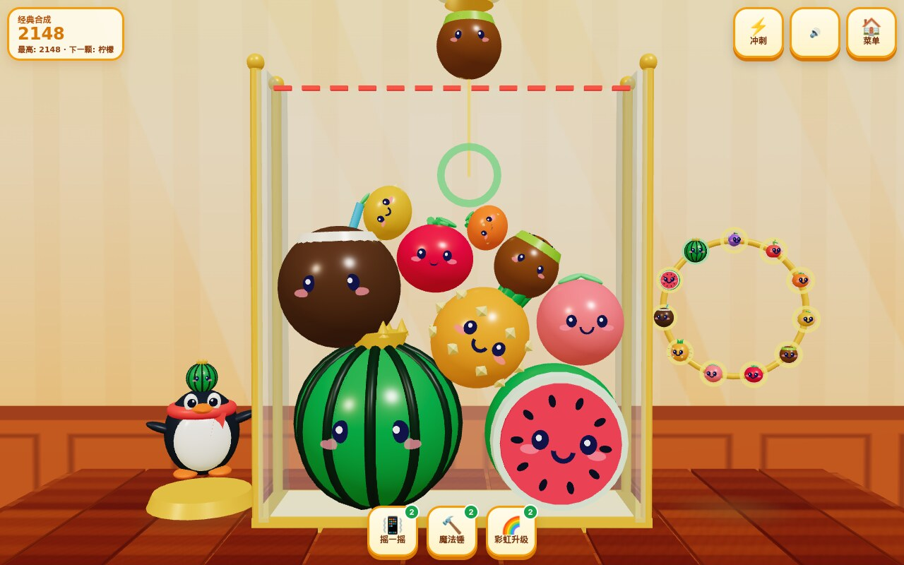

# 🍉 合成大西瓜 3D — Synthetic Big Watermelon 3D

**Live Game (GitHub Pages)**: [https://kunruiw1991.github.io/qq-watermelon-3d/](https://kunruiw1991.github.io/qq-watermelon-3d/)  
**Repository**: [https://github.com/kunruiw1991/qq-watermelon-3d](https://github.com/kunruiw1991/qq-watermelon-3d)



A vibrant, kid-friendly and nostalgic **Three.js r170 WebGL2** 3D remake of **Synthetic Big Watermelon (`合成大西瓜 3D`)**, featuring an 11-tier bespoke 3D fruit evolution chain, 240Hz substepped crystal-jar rigid-body physics, a cheering 3D QQ Penguin companion, a 3D Fruit Evolution Ring, three interactive power-up tools, and synthesized WebAudio kalimba/marimba chimes.

---

## ✨ Key Features

1. **11-Tier Bespoke 3D Fruit Evolution Chain (`0 → 10`)**:
   - `0` **Grape (`葡萄`)** → `1` **Cherry (`樱桃`)** → `2` **Mandarin (`橘子`)** → `3` **Lemon (`柠檬`)** → `4` **Kiwi (`猕猴桃`)** → `5` **Tomato (`西红柿`)** → `6` **Peach (`水蜜桃`)** → `7` **Pineapple (`菠萝`)** → `8` **Coconut (`椰子`)** → `9` **Half-Melon (`半个西瓜`)** → `10` **Big Watermelon (`大西瓜`)**.
   - Every tier features multi-part 3D geometry (berry clusters, curved stems, citrus dimples, kiwi seeds, pineapple diamond scales, cut watermelon flesh & seeds, dark-green meridian stripes, golden crown, and kawaii 3D eyes/expressions).
   - Merging two **Big Watermelons (`10 + 10`)** triggers the **Golden Watermelon Fountain Bonus (`+500` pts + fireworks)**!

2. **240Hz Substepped Rigid-Body Jar Physics**:
   - Fixed timestep (`FIXED_DT = 1/60`, 4 substeps per frame = 240Hz solver) with circle-wall, circle-floor, and circle-circle elastic impulse + positional relaxation and tangential 3D rolling spin (`omega`).
   - Boolean Set merge guard ensures simultaneous triple-contact collisions (`A-B-C`) consume strictly one pair (`A + B → tier + 1`) while leaving `C` intact.
   - **2.5s Overflow Warning Rim**: Newly dropped fruits receive a `1.5s` spawn-drop grace window; settled fruits exceeding the top dashed warning line for `2.5s` end the match and transition to the **3D Top-3 Star Podium**.

3. **2 Game Modes & 3 Power-Up Tools**:
   - **Classic Merge (`经典合成`)** and **2-Minute Watermelon Rush (`限时冲刺`)**.
   - **Shake Jar (`📳 摇一摇`)**: Physical 3D container jolt that nudges separated fruits together.
   - **Magic Hammer (`🔨 魔法锤`)**: Tap any 3D fruit inside the crystal jar via 3D raycast to smash it and clear space.
   - **Rainbow Upgrade (`🌈 彩虹升级`)**: Immediately upgrades the currently held fruit in the claw dropper by `+1` tier.

---

## 🎮 Controls (iPad Touch & Desktop)

- **Touch / Mouse**: Drag horizontally anywhere over the 3D crystal jar to aim with the glowing laser drop line and 3D landing ring; release to drop.
- **Keyboard**:
  - `ArrowLeft` / `ArrowRight` or `A` / `D`: Aim claw dropper left / right
  - `Space` / `Enter` / `ArrowDown` / `S`: Drop held fruit
  - `1` / `Q`: Shake Jar (`摇一摇`)
  - `2` / `W`: Magic Hammer (`魔法锤`)
  - `3` / `E`: Rainbow Upgrade (`彩虹升级`)
  - `M`: Mute / Unmute WebAudio BGM & SFX

---

## 🧪 Running the Headless WebGL2 E2E Suite

```bash
python3 tests/run_e2e.py
```
